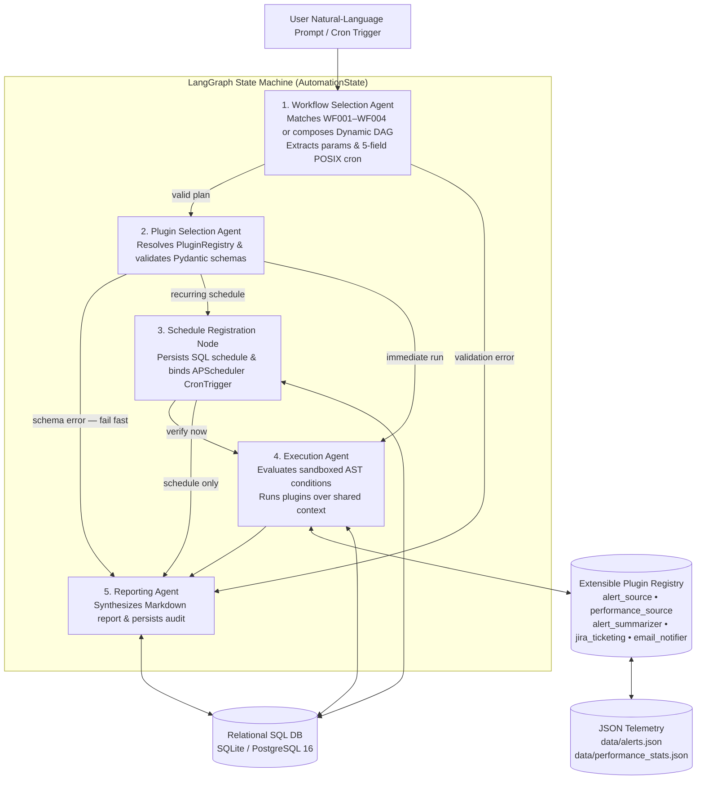

<div align="center">

# ⚡ Agentic Workflow Automation Engine

**An autonomous, multi-agent IT operations orchestration engine powered by LangGraph, FastAPI, SQLAlchemy, and APScheduler.**

[](https://www.python.org/)
[](https://fastapi.tiangolo.com/)
[](https://langchain-ai.github.io/langgraph/)
[](https://www.sqlalchemy.org/)
[](#testing--verification)
[](#docker-production-stack)

[Architecture](#-system-architecture) • [Core Capabilities](#-core-engineering-capabilities) • [Quick Start](#-quick-start) • [Benchmark Prompts](#-verified-benchmark-workflows) • [API Reference](#-api-reference) • [Design Trade-Offs](#-architectural-trade-offs)

</div>

---

## 🎯 Overview & Design Philosophy

IT operations teams rely on repetitive alert triage, incident ticketing, and network KPI reporting across disconnected systems. Traditional hardcoded scripts break whenever workflows need to be recombined, while unconstrained ReAct LLM agents risk hallucinating tool parameters, skipping validation, or duplicating external actions.

This engine bridges both worlds by **separating reasoning from execution**:

> **Plan once with AI → Validate deterministically → Execute & audit safely in SQL.**

1. **Natural-Language Chat Execution:** Users describe operational intent in plain English; the multi-agent graph selects a predefined workflow (`WF001`–`WF004`) or dynamically synthesizes a reusable multi-step DAG (`WF_DYN_...`), validates parameters via Pydantic, and executes it.
2. **Zero-LLM Recurring Schedules:** Recurring requests (daily, weekly, monthly, or custom cron) are persisted in SQL and bound to live `APScheduler` triggers. Subsequent cron runs bypass the LLM completely—ensuring zero recurring token cost and 100% deterministic execution.
3. **Full Observability:** Every run, conditional branch evaluation, step latency, created ticket, and dispatched email is recorded in SQL and surfaced through an interactive monitoring dashboard.

---

## 🏗 System Architecture



### Multi-Agent Pipeline Responsibilities

| Stage | Module | Role |
| :--- | :--- | :--- |
| **Workflow Selection Agent** | `app/agents/workflow_selector.py` | Uses structured LLM output (Gemini / OpenAI) with an automatic offline deterministic fallback to route to `WF001`–`WF004` or synthesize & persist a new dynamic DAG (`WF_DYN_...`). |
| **Plugin Selection Agent** | `app/agents/plugin_selector.py` | Fail-fast validation gate. Verifies every plugin exists in `PluginRegistry` and validates all parameters against strict Pydantic schemas before any external side effect occurs. |
| **Schedule Registration** | `app/scheduler/service.py` | Persists recurring jobs to SQL `schedules`, registers live `CronTrigger` jobs in APScheduler, and auto-syncs active schedules on server startup. |
| **Execution Agent** | `app/agents/executor.py` | Coordinates sequential step execution over a shared `context` dictionary, evaluates AST conditions, halts cleanly on failure, and logs per-step latency (`duration_ms`) and payloads to SQL. |
| **Reporting Agent** | `app/agents/reporter.py` | Compiles alert summaries, regional KPIs, ticket keys, email delivery statuses, and step audits into a final Markdown report stored in `workflow_executions`. |

---

## ✨ Core Engineering Capabilities

### 1. Unified Predefined & Dynamic Workflows
Both predefined templates and AI-composed dynamic pipelines share an identical JSON DAG schema (`{name, plugin, condition, params}`), enabling the same executor, scheduler, and audit trail to run everything uniformly.

| Code | Workflow Name | Default Pipeline |
| :--- | :--- | :--- |
| `WF001` | **Daily Alert Summary** | `alert_source` (`always`) → `alert_summarizer` (`alert_count >= 0`) |
| `WF002` | **Ticket Creation** | `alert_source` (`always`) → `jira_ticketing` (`alert_count > 0`) |
| `WF003` | **Email Notification** | `email_notifier` (`always`) |
| `WF004` | **Performance Report** | `performance_source` (`always`) |
| `WF_DYN_*` | **Dynamically Composed DAGs** | Automatically synthesized and saved to SQL when a prompt chains multiple actions or conditions. |

### 2. Sandboxed AST Conditional Evaluation (Zero `eval()`)
Step conditions (`always`, `alert_count > 0`, `critical_count > 0`, `down_links > 0`) are evaluated via a custom parser in `app/agents/condition_eval.py` built on Python's `ast.parse(..., mode="eval")`:
- **Allowlisted Nodes Only:** Supports `Constant`, `Name`, `Compare`, `BoolOp`, `UnaryOp`, `BinOp`, `List`, and `Tuple`.
- **Deny-by-Default Security:** `ast.Call` and `ast.Attribute` are strictly excluded, making arbitrary code execution or object introspection impossible.
- **Explicit Auditability:** Unmet conditions safely skip the step and record `condition_met=False, status="skipped"` in `execution_step_logs`.

### 3. Open/Closed Decorator Plugin Architecture
All integrations inherit from `BasePlugin` (`app/plugins/base.py`) and self-register via `@registry.register`. Adding a new integration (e.g., Slack or PagerDuty) requires **zero changes** to the LangGraph graph, executor, or API routes:

```python
from pydantic import BaseModel, Field
from app.plugins.base import BasePlugin
from app.plugins.registry import register_plugin

class SlackParams(BaseModel):
    channel: str = Field(default="#ops-alerts")

@register_plugin
class SlackNotifierPlugin(BasePlugin):
    name = "slack_notifier"
    category = "notification"
    description = "Posts alert summaries to a Slack channel."
    input_schema = SlackParams

    def execute(self, params: dict, context: dict) -> dict:
        cfg = self.validate_params(params)
        return {"channel": cfg.channel, "delivered": True}
```

#### Built-in Plugins

| Plugin | Category | Capabilities & Guardrails |
| :--- | :--- | :--- |
| `alert_source` | `data_source` | Filters `data/alerts.json` by `intensities`, `unresolved_only`, `min_active_minutes`, `client`, `label`, and `bucket`. |
| `performance_source` | `data_source` | Computes link uptime, score, active-link latency, packet drop, and worst circuits from `data/performance_stats.json`; handles zero-match regions without fabricating metrics. |
| `alert_summarizer` | `analytics` | Builds deterministic severity/client breakdowns with optional LLM executive briefings. |
| `jira_ticketing` | `ticketing` | Persists prioritized incident tickets to SQL with **`alert_uid` deduplication** (preventing cron spam) and optional live Jira REST v3 integration. |
| `email_notifier` | `notification` | Dynamically composes Markdown reports from upstream steps, delivers via `STARTTLS` SMTP when configured, and always logs to SQL `email_logs`. |

### 4. Hybrid Database Design (SQLAlchemy 2.0 + JSON Telemetry)
Operational metadata is persisted in SQL (SQLite locally; PostgreSQL 16 in production via `DATABASE_URL`), while raw telemetry remains decoupled in JSON files:

| Table | Responsibility |
| :--- | :--- |
| `workflows` | Predefined (`WF001`–`WF004`) and dynamically synthesized (`WF_DYN_*`) DAG definitions |
| `schedules` | Cron expressions, extracted parameters, `last_run_at`, and `next_run_at` |
| `workflow_executions` | Parent run metadata (`trigger_type`, `user_prompt`, `status`, `final_report`) |
| `execution_step_logs` | Granular per-step inputs, outputs, AST condition outcomes, and `duration_ms` |
| `tickets` | Created Jira/incident tickets indexed by `alert_uid` for deduplication |
| `email_logs` | Full outbox audit trail with delivery mode (`smtp` / `simulated_db`) |
| `chat_messages` | Session-scoped conversation history linked to `execution_id` |

---

## 🚀 Quick Start

### 1. Local Setup

```bash
# Clone & create virtual environment
python -m venv .venv
source .venv/bin/activate       # Windows: .venv\Scripts\activate

# Install dependencies
pip install -r requirements.txt

# Create local environment file (optional — works offline out-of-the-box)
cp .env.example .env
```

### 2. Run the Server

```bash
uvicorn app.main:app --reload --port 8000
```

- **Web Dashboard UI:** [http://127.0.0.1:8000](http://127.0.0.1:8000) *(Chat Console, Workflows, Schedules, Executions, Tickets & Emails, Plugins)*
- **Interactive API Docs (Swagger):** [http://127.0.0.1:8000/docs](http://127.0.0.1:8000/docs)

### 3. Environment Configuration (`.env`)

All external credentials are optional; leaving them blank enables deterministic planning, local SQLite storage, and SQL outbox logging automatically.

| Variable | Default | Purpose |
| :--- | :--- | :--- |
| `DATABASE_URL` | `sqlite:///./workflow_engine.db` | SQLAlchemy connection string (`postgresql+psycopg2://...` for Postgres) |
| `LLM_PROVIDER` | `gemini` | `gemini`, `openai`, or `mock` |
| `GOOGLE_API_KEY` / `OPENAI_API_KEY` | *(blank)* | Enables live LLM structured workflow planning & executive summaries |
| `GEMINI_MODEL` | `gemini-2.5-flash` | Gemini model identifier |
| `SMTP_HOST`, `SMTP_PORT`, `SMTP_USER`, `SMTP_PASSWORD` | *(blank)* | Enables live `STARTTLS` email delivery (e.g., Gmail App Password) |
| `DEFAULT_OPS_EMAIL` | `ops-team@company.com` | Default recipient when prompt targets "operations team" |
| `JIRA_BASE_URL`, `JIRA_EMAIL`, `JIRA_API_TOKEN` | *(blank)* | Enables live Jira REST v3 issue creation |

---

## 🧪 Verified Benchmark Workflows

The engine is validated against `data/alerts.json` (9 operational alerts) and `data/performance_stats.json` (152 TATA MPLS links across `mangaluru Zone` and `Shivamogga Zone`).

<details open>
<summary><b>Prompt 1 — Scheduled + Dynamic + Conditional Alert Triage</b></summary>

> *"Every day at 9 AM, check all unresolved down and high operational alerts, generate a summary, create a ticket for each critical incident and email the report to the operations team."*

```bash
curl -X POST http://127.0.0.1:8000/api/chat \
  -H "Content-Type: application/json" \
  -d '{"prompt": "Every day at 9 AM, check all unresolved down and high operational alerts, generate a summary, create a ticket for each critical incident and email the report to the operations team."}'
```

**Observed Execution:**
- **Schedule:** Registers daily cron `0 9 * * *` in SQL `schedules` + APScheduler.
- **Dynamic DAG (`WF_DYN_...`):** `alert_source` → `alert_summarizer` → `jira_ticketing [if critical_count > 0]` → `email_notifier`.
- **Results:** Matches **5 unresolved `DOWN`/`HIGH` alerts** (excluding acknowledged alerts `SR601810` & `SR601811`), creates **2 `CRITICAL` tickets** (`140093-LAN-10.20.0.252`, `150351-LAN-10.20.1.13`), and dispatches/logs the report to `ops-team@company.com`.

</details>

<details>
<summary><b>Prompt 2 — Predefined WF002 (High-Priority Jira Ticketing & Deduplication)</b></summary>

> *"Create a high-priority Jira ticket for all devices that have been down for more than 15 minutes."*

```bash
curl -X POST http://127.0.0.1:8000/api/chat \
  -H "Content-Type: application/json" \
  -d '{"prompt": "Create a high-priority Jira ticket for all devices that have been down for more than 15 minutes."}'
```

**Observed Execution:**
- **Routing:** Matches predefined workflow `WF002` (`Ticket Creation`) with `intensities=['DOWN']`, `min_active_minutes=15`, `priority='HIGH'`.
- **Results:** Identifies all **4 qualifying `DOWN` devices** (`290004-BANTWAL-3101-D`, `240031-SHIVAMOGGA-426-IPDS`, `140093-LAN-10.20.0.252`, `150351-LAN-10.20.1.13`), preserves linked external ticket references (`SR601810`, `SR601811`), and automatically deduplicates any already-open tickets in SQL.

</details>

<details>
<summary><b>Prompt 3 — Dynamic Performance Report & Zero-Match Edge-Case Handling</b></summary>

> *"Generate the performance report for Mumbai for last 6 hours and email it to test@gmail.com"*

```bash
curl -X POST http://127.0.0.1:8000/api/chat \
  -H "Content-Type: application/json" \
  -d '{"prompt": "Generate the performance report for Mumbai for last 6 hours and email it to test@gmail.com"}'
```

**Observed Execution:**
- **Dynamic DAG (`WF_DYN_...`):** `performance_source` → `email_notifier`.
- **Results:** Gracefully reports **0 matching links for `Mumbai`** without crashing or hallucinating KPIs, lists available zones (`mangaluru Zone`: 82 links / 22 down / 71.07% uptime; `Shivamogga Zone`: 70 links / 30 down / 54.25% uptime) plus the 152-link dataset baseline (63.32% avg uptime), and delivers/logs the email to `test@gmail.com`.

</details>

---

## 📡 API Reference

| Group | Method & Endpoint | Description |
| :--- | :--- | :--- |
| **Chat** | `POST /api/chat` | Execute or schedule a workflow from natural language |
| **Workflows** | `GET /api/workflows` · `POST /api/workflows` | List predefined/dynamic workflows or register a custom DAG |
| **Workflows** | `POST /api/workflows/{code}/execute` | Manually execute a workflow with optional parameter overrides |
| **Schedules** | `GET /api/schedules` · `POST /api/schedules` | List or register recurring cron schedules |
| **Schedules** | `POST /api/schedules/{id}/trigger` · `DELETE /api/schedules/{id}` | Trigger a scheduled job immediately or deactivate it |
| **Audit** | `GET /api/executions` · `GET /api/executions/{id}` | Inspect workflow execution runs, AST condition results, and step latencies |
| **Artifacts** | `GET /api/tickets` · `GET /api/emails` · `GET /api/plugins` | Inspect SQL tickets, email outbox logs, and plugin JSON schemas |
| **Probes** | `GET /health` · `GET /live` · `GET /ready` | Production health, Kubernetes liveness, and readiness probes |

---

## ⚖️ Architectural Trade-Offs

| Dimension | Implemented Choice | Alternatives Considered | Why This Architecture |
| :--- | :--- | :--- | :--- |
| **Orchestration** | LangGraph `StateGraph` (4 specialized agents) | Single ReAct loop / Multi-agent chat | Deterministic fail-fast validation before side effects; clear audit boundaries per stage. |
| **Conditionals** | Sandboxed Python AST Evaluator | `eval()` / Per-step LLM checks | Eliminates RCE risk, executes in < 0.1 ms, and incurs zero token overhead. |
| **Plugins** | Decorator `PluginRegistry` + Pydantic | Hardcoded `if/elif` blocks / Microservices | Open/Closed extensibility with automatic LLM JSON-schema discovery and zero orchestration edits. |
| **Scheduling** | SQL-synced APScheduler (`CronTrigger`) | Celery Beat + Redis / OS `crontab` | Zero external broker required locally; cleanly abstracted behind `WorkflowSchedulerService` for future multi-worker scaling. |
| **AI Resilience** | Structured LLM + Deterministic Fallback | LLM-only / Regex-only | Combines natural-language adaptability with 100% offline testability and quota resilience. |

---

## ✅ Testing & Verification

Run the automated integration and unit test suite:

```bash
pytest -v
```

```text
tests/test_engine.py::test_predefined_workflows_seeded                    PASSED
tests/test_engine.py::test_plugin_registry                                PASSED
tests/test_engine.py::test_safe_ast_condition_eval                        PASSED
tests/test_engine.py::test_prompt_1_scheduled_alert_triage                PASSED
tests/test_engine.py::test_prompt_2_jira_ticketing_down_devices           PASSED
tests/test_engine.py::test_prompt_3_performance_report_mumbai             PASSED
tests/test_engine.py::test_performance_report_mangaluru_and_shivamogga    PASSED
tests/test_engine.py::test_api_chat_endpoint                              PASSED
tests/test_engine.py::test_api_workflows_and_manual_execution             PASSED
tests/test_engine.py::test_api_schedules_crud                             PASSED
tests/test_engine.py::test_api_executions_and_tickets_and_emails          PASSED
==================== 11 passed ====================
```

---

## 🐳 Docker Production Stack

Launch the full multi-container production stack (**FastAPI + PostgreSQL 16**):

```bash
docker compose up --build -d

# Verify database connectivity and scheduler health
curl http://localhost:8000/health
```

For full deployment runbooks covering **Docker, Kubernetes, AWS ECS, GCP Cloud Run, and Render/Railway**, see **[DEPLOYMENT.md](DEPLOYMENT.md)**.

---

## 📁 Project Structure

<details>
<summary>Click to expand full directory tree</summary>

```text
.
├── README.md
├── DEPLOYMENT.md
├── requirements.txt
├── .env.example
├── data/
│   ├── alerts.json                 # Operational alert telemetry (9 alerts)
│   └── performance_stats.json      # Network link performance telemetry (152 links)
├── app/
│   ├── config.py                   # Pydantic-settings environment loader
│   ├── main.py                     # FastAPI app, lifespan sync & dashboard mount
│   ├── agents/
│   │   ├── state.py                # AutomationState TypedDict & LLM output schemas
│   │   ├── llm.py                  # Gemini / OpenAI client with graceful fallback
│   │   ├── condition_eval.py       # Sandboxed Python AST condition evaluator
│   │   ├── workflow_selector.py    # Workflow Selection Agent (predefined + dynamic)
│   │   ├── plugin_selector.py      # Plugin Selection & Pydantic validation gate
│   │   ├── executor.py             # Execution Agent with SQL step audit logging
│   │   ├── reporter.py             # Reporting Agent (Markdown synthesis)
│   │   └── graph.py                # Compiled LangGraph StateGraph
│   ├── plugins/
│   │   ├── base.py                 # BasePlugin abstract contract
│   │   ├── registry.py             # PluginRegistry & @register_plugin decorator
│   │   ├── alert_plugin.py         # alert_source
│   │   ├── performance_plugin.py   # performance_source
│   │   ├── summary_plugin.py       # alert_summarizer
│   │   ├── ticket_plugin.py        # jira_ticketing (SQL deduplication + Jira v3)
│   │   └── email_plugin.py         # email_notifier (STARTTLS SMTP + SQL outbox)
│   ├── db/
│   │   ├── database.py             # SQLAlchemy 2.0 engine & session management
│   │   ├── models.py               # 7 relational ORM tables
│   │   └── seed.py                 # Predefined workflow seeder (WF001–WF004)
│   ├── scheduler/
│   │   └── service.py              # SQL-synced APScheduler CronTrigger service
│   ├── api/
│   │   ├── schemas.py              # Request/response Pydantic models
│   │   └── routes.py               # REST API & health/readiness endpoints
│   └── static/
│       └── index.html              # Single-page Tailwind operations dashboard
└── tests/
    └── test_engine.py              # 11-test unit & end-to-end integration suite
```

</details>
